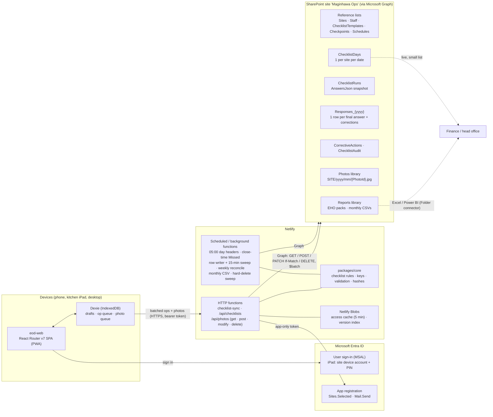

# Key every checklist by site and date

*Research report, 6 November 2026. All volumes, sizes and costs are estimates or examples, not real Maginhawa data. Sources are Microsoft Learn unless marked "community". Statements are labelled as **verified** (with a source), **recommendation** (our reasoning), or **test** (check in the real tenant before relying on it).*

Store each site's day as **one small header item** in a `ChecklistDays` list, keyed by a unique text key such as `BUN|2026-11-06`, and hang everything else off that key. Group the day's existing per-template runs under it with a `DayKey` column. While a run is open, keep its answers as a **JSON snapshot on the run item**, written with `If-Match`. When the run is finished, write the answers out as **one typed row per answer** into a year-partitioned `Responses_{yyyy}` list for reporting and the audit trail. Photos go into the existing **Photos library** as write-once files named by a device-generated `PhotoId`. Answers point to them by `PhotoId` and driveItem id, never by URL. The plan matters because SharePoint Online's **5,000-item view threshold cannot be raised** ([Microsoft Support](https://support.microsoft.com/en-us/office/manage-large-lists-and-libraries-b4038448-ec0e-49b7-b853-679d3d8fb784)), and Graph can filter on **only one indexed field at a time** ([Graph listItem list](https://learn.microsoft.com/en-us/graph/api/listitem-list?view=graph-rest-1.0)). A good key therefore decides whether head office can still find a checklist in year three. A nightly job gives every active site one header for every day, with status Due, Submitted, Late, Missed or Not trading, so a missing day is a recorded fact rather than an absence. Our own API covers get, post, modify and delete. A finished checklist is changed only by a correction with a reason, deleting is a soft delete by default, and only head office can hard-delete. Most of the current list spec survives. Five things in it must change before go-live: Date columns used as keys, lookup columns, the live append-only `Responses` list growing past the point where indexes can be added, the `PhotoUrl` hyperlink, and the reliance on Purview record labels for list items.

## What the current spec gets right, and five things to fix first

The spec in `docs/tech-plan/sharepoint/sharepoint-lists.json` already follows the right pattern. It uses unique text `Title` keys (`SiteCode|date|…`), index flags on site, date and status, a scheduled function for runs, append-only corrections with `Supersedes`, and a Photos library foldered `Site/yyyy/mm`. HANDOFF §4 sync rule 5 relies on unique `Title` keys, so this plan keeps `Title` as the key column. It adds a readable `Label` column for people, rather than the separate `DayKey` key column some sources suggest. The research shows five problems.

| # | Current spec | Problem (verified unless marked) | Change |
|---|---|---|---|
| 1 | `BusinessDate` (Date) on runs, responses and day closures, used for filtering | SharePoint stores a date-only value as midnight in the site's time zone, so in British Summer Time "2026-07-01" reads back from Graph as 30 June 23:00Z. Writing a full DateTime caused off-by-one dates in Power BI (community: [K2](https://help.k2.com/kb001739), [Fabric community](https://community.fabric.microsoft.com/discussions/power-bi-designer/suddenly-wrong-dates-in-powerbi/4905162)) | Add a text `BusinessDateKey` (`yyyy-MM-dd`, indexed) for keys and range filters. Keep the Date column for display only, written as a plain `yyyy-MM-dd` string. Set the site's time zone to London |
| 2 | Lookups: `Site`, `Template`, `Run`, `CompletedBy`, `RecordedBy`, `Device`, `Response` | To write a lookup you must first resolve the target item's integer id (`{Field}LookupId`) ([fieldValueSet](https://learn.microsoft.com/en-us/graph/api/resources/fieldvalueset)). Lookup and person columns count towards the 12-join limit ([Microsoft Support](https://support.microsoft.com/en-us/office/manage-large-lists-and-libraries-b4038448-ec0e-49b7-b853-679d3d8fb784)). Power Query's v2.0 connector is subject to the same limit ([Power Query connector](https://learn.microsoft.com/en-us/power-query/connectors/sharepoint-online-list)) | Use plain text keys (`SiteCode`, `TemplateId`, `RunKey`, `AnswerKey`), and store people as Entra object id + display name text. An offline device can compute a text key, but it can't know an item id |
| 3 | One `Responses` list, written live for every answer, append-only, about 410k rows a year | Automatic indexing stops above 20,000 items, and a 2017 community post says manual indexes can't be added above that either ([M365 community docs](https://learn.microsoft.com/microsoft-365/community/large-lists-large-libraries-in-sharepoint); [sympmarc](https://sympmarc.com/2017/11/08/predictive-indexing-comes-to-office-365-lists-and-libraries/)). At about 1,250 rows a day that point arrives in about 16 days. Unindexed filters return `400 … is not indexed` (community: [Microsoft Q&A](https://learn.microsoft.com/en-us/answers/questions/1359977/error-received-on-request-with-400-status-code-inv)) | Create every index in the provisioning script before go-live. Partition by year (`Responses_2026`, `Responses_2027`). Write rows once, at Finish, so in-progress re-answers don't pile up as extra rows |
| 4 | `PhotoUrl` (Hyperlink) | Writing Hyperlink/Picture columns through Graph was reported unsupported, with only an unverified header workaround (community: [Microsoft Q&A](https://learn.microsoft.com/en-us/answers/questions/1382210/how-to-make-post-patch-request-to-add-hyperlink-pi)). The pre-authenticated `downloadUrl` lasts about an hour and "can't be cached" ([driveItem](https://learn.microsoft.com/en-us/graph/api/resources/driveitem?view=graph-rest-1.0)) | Store `PhotoIds` and `PhotoItemIds` (driveItem ids) as text. Build display URLs on request. `DayClosures.ReportLink` changes the same way |
| 5 | `Responses` protected by "append-only by convention + Purview record label" | Labels that mark items as records need **E5-tier** rights ([Purview service description](https://learn.microsoft.com/en-us/office365/servicedescriptions/microsoft-365-service-descriptions/microsoft-365-tenantlevel-services-licensing-guidance/microsoft-purview-service-description)). Graph applies labels only to driveItems ([setRetentionLabel](https://learn.microsoft.com/en-us/graph/api/driveitem-setretentionlabel)); list items need CSOM ([CSOM methods](https://learn.microsoft.com/en-us/sharepoint/dev/apis/csom-methods-for-applying-retention-labels)). A locked record still allows property edits by default, and a list item's data *is* its properties ([Records management](https://learn.microsoft.com/en-us/purview/records-management)) | Rely on app-enforced locking, read-only access for people, versioning, a site retention policy and a content hash (see the retention section). Use record labels only if the tenant already has E5 |

Smaller fixes: `Responses.CheckpointId` is a Number but checkpoint ids in `packages/core` are strings, so make it Text. `Passed` (Yes/No) can't tell "not evaluated" from "failed", because Yes/No columns default to No (unverified, community). Replace it with a `Result` choice of Pass / Fail / None. Finally, the spec's run key (`SiteCode|date|ScheduleId`) doesn't match `runKey()` in `checklists.ts` (`date|templateId|dueTime`). Align on `SITE|yyyy-MM-dd|templateId|HH:MM` (or `|any`). This is the core key with the site code at the front, which the memory store already adds.

## One header per site-day groups the runs and records the gaps

The brief says "one checklist per site per day". The app, though, already runs several templates a day (opening, closing, temperatures at set times, re-checks). Each template-and-time pair is a `ChecklistRun` in both the spec and `tasksForDay()`. **Recommendation:** keep runs as they are, and add a per-site-per-day header that groups them. `DayClosures` already has exactly this key (`SiteCode|yyyy-mm-dd`, unique) and a `Stats` JSON column. Extend it and rename it `ChecklistDays`, rather than adding a third list keyed on site and date next to `TradingDays`. *(Open question for the user: keep "DayClosures" as the name, or rename.)*

The header list stays small. With 8 sites × 365 days, it gets **about 2,920 items a year at most** (estimate). Indexed range queries keep working long after it passes 5,000. Lists hold up to 30 million items ([SharePoint limits](https://learn.microsoft.com/en-us/office365/servicedescriptions/sharepoint-online-service-description/sharepoint-online-limits)).

### Proposed lists and columns

`I` = indexed, `U` = enforce unique values, `R` = required, `S` = set by the server only.

**ChecklistDays** (replaces DayClosures; one per active site per date)

| Column | Type | Flags | Notes |
|---|---|---|---|
| Title | Text | IUR | `DayKey` = `BUN\|2026-11-06` |
| Label | Text | | "Bunso · Fri 6 Nov 2026", for people and list search |
| SiteCode | Text | I | |
| BusinessDateKey | Text | I | `2026-11-06`; sorts and ranges lexically |
| BusinessDate | Date | | Display and Power BI date tables only |
| Status | Choice | I | Due / In progress / Submitted / Late / Missed / Not trading / Deleted / Deleting |
| DeletedAt, DeletedById, DeletedByName, DeletedReason | DateTime, Text, Text, Text | S | Soft delete (see "Get, post, modify and delete") |
| ExpectedRuns, CompletedRuns, MissedRuns, FailedCount, OpenFixes | Number | S | Summary for head office views |
| SubmittedAt, SubmittedById, SubmittedByName | DateTime, Text, Text | S | Last run finished (server time) |
| MissedDetectedAt | DateTime | S | Set once by the nightly job. Never cleared, even if a late submission arrives |
| NotTradingReason | Text | | Head office: closure, refurb, holiday |
| DayHash | Text | S | SHA-256 over the finished runs' hashes |
| Stats | Multi-line text | S | Kept from DayClosures |
| ReportItemId | Text | S | driveItem id of the PDF in Reports (replaces the `ReportLink` hyperlink) |

**ChecklistRuns** (kept; lookups removed; JSON added)

| Column | Type | Flags | Notes |
|---|---|---|---|
| Title | Text | IUR | `RunKey` = `BUN\|2026-11-06\|closing\|22:30` |
| DayKey | Text | I | Groups the day's runs. "All runs for a day" is one filter on this column |
| SiteCode, BusinessDateKey | Text | I | |
| TemplateId, TemplateVersion, DueTime, DueAt | Text, Number, Text, DateTime | | `TemplateId` replaces the lookup |
| Status | Choice | I | Scheduled / In progress / Completed / Missed / Auto-closed / Cancelled / Deleted |
| DeletedAt, DeletedById, DeletedReason | DateTime, Text, Text | S | Soft delete of one run |
| AnswersJson | Multi-line **plain** text | S | Snapshot of the run's answer records: value, who, when, fix, corrections, per-answer `seq` |
| SchemaVersion | Number | S | Version of the JSON shape |
| Seq | Number | S | Raised on every successful write. The Finish `seen` check compares against it |
| CompletedAt, CompletedById, CompletedByName, DurationSeconds, FailedCount | | S | |
| RecheckOf | Text | | `RunKey\|checkpointId` |
| RowsStatus | Choice | I | Pending / Written. Acts as the queue for the background row writer |
| RunHash | Text | S | SHA-256 of the canonical finished JSON |

**Responses_{yyyy}** (one list per business-date year; written at Finish and on each correction; never edited)

| Column | Type | Flags | Notes |
|---|---|---|---|
| Title | Text | IUR | `RowKey` = `AnswerKey\|rev` (rev 0 = original, 1… = corrections). Deterministic, so a retried write gets a conflict, not a duplicate |
| AnswerKey | Text | I | `RunKey\|checkpointId` |
| DayKey | Text | I | Answers for one day: at most a few hundred rows |
| BusinessDateKey | Text | I | Date-range exports |
| CheckpointId | Text | I | One question over a year is about 2,920 rows (8 × 365), under the threshold |
| SiteCode, RunKey, TemplateId, TemplateVersion, CheckpointTitle | Text | | Title is a snapshot, so later template edits don't rewrite history |
| AnswerType | Choice | | yesno / temp / number / text / photo / choice / date / sign, matching `ANSWER_TYPES` |
| ValueNumber, ValueBool, ValueText, ValueDateKey, ValueDisplay | Number, Choice (yes/no/blank), Multi-line, Text, Text | | Sparse: only the column for the answer type is filled. `ValueDisplay` is readable in Excel for any row |
| Result | Choice | | Pass / Fail / None (replaces `Passed`) |
| ThresholdSnapshot, Source, CapturedLive | | | Unchanged |
| PhotoIds, PhotoItemIds, PhotoSha256 | Text | | Replaces `PhotoUrl` |
| AnsweredById, AnsweredByName, AnsweredAt | Text, Text, DateTime | | `AnsweredAt` is capped at server time, as in `checklist-sync.ts` |
| Rev, Supersedes, CorrectionReason, CorrectedAt | Number, Text, Text, DateTime | | `Supersedes` holds the earlier `RowKey`, not an item id |

`CorrectiveActions` needs the same treatment: replace the `Response` and `Site` lookups with `AnswerKey`, `DayKey` and `SiteCode` text. `Schedules` should use `TemplateId` and `SiteCode` text, and add `EffectiveFrom`/`EffectiveTo` text dates. The missing-day calculation needs to know what was expected *on that date*, not just what is expected today. `ChecklistTemplates` and `Checkpoints` are unaffected apart from the same lookup clean-up.

**Index budget:** no list goes above six indexes. That leaves room under the 20-per-list cap HANDOFF records. That cap was not re-verified in this research (test).

## Saving: one conditional write per batch, answer rows after Finish

**Verified constraints.** For an app in a tenant with 0–1,000 licences, Graph allows **1,250 resource units (RU) per minute** and 1.2 million a day. A create or update costs 2 RU and a single-item GET costs 1 RU ([Avoid throttling, Aug 2026](https://learn.microsoft.com/en-us/sharepoint/dev/general-development/how-to-avoid-getting-throttled-or-blocked-in-sharepoint-online)). A `$batch` holds at most 20 requests. Each sub-request is throttled and can fail on its own, and an overall 200 doesn't mean the sub-requests succeeded ([JSON batching](https://learn.microsoft.com/en-us/graph/json-batching)). PATCH with `If-Match` returns **412** on a stale ETag and changes nothing ([Update listItem](https://learn.microsoft.com/en-us/graph/api/listitem-update?view=graph-rest-1.0)). Netlify Functions get about 10 seconds per synchronous call (HANDOFF §4).

These numbers favour the JSON-on-the-run design over writing a live row per answer. With one row per answer, eight sites each finishing 80 answers around 23:00 is 640 creates, about 1,280 RU. That alone is over the per-minute budget (estimate). Re-answers before Finish would also leave superseded rows in an append-only list. With the run snapshot, a batch of ops costs **one GET by key plus one PATCH, about 3–4 RU** whatever its size.

The run snapshot also maps directly onto `MemoryChecklistStore.apply()`. That code is already the server's rules in memory: per-answer last-write-wins by `answeredAt`, capped at the server clock; a stale Finish refused with the unseen answers; and corrections that keep the old answer. The SharePoint store runs the same `applyOne` logic on the loaded JSON and saves it with `If-Match`. On a 412 it reloads and re-applies. This is the same rule the EOD store already follows (`store.ts` obligations 1–4).

| Step | Call(s) | Approx. RU |
|---|---|---|
| 1. Device sends a batch `{siteCode, ops[]}` (no call per answer, scalability rule 1) | `POST /api/checklist-ops` | — |
| 2. Load the run | `GET …/ChecklistRuns/items?$filter=fields/Title eq 'BUN\|2026-11-06\|closing\|22:30'&expand=fields(select=…)` | 2 |
| 3. If missing, create it | `POST` with the unique `Title`. Treat **any 409** as "already exists" and GET again; don't parse the message | 2 |
| 4. Apply the ops with the `checklist-sync` rules; raise `Seq`; PATCH `AnswersJson`, `Status`, `Seq` with `If-Match` | On 412: reload and re-apply, up to N times | 2 |
| 5. First answer of the day: set the header to In progress | PATCH `ChecklistDays` with `If-Match` | 2 |
| 6. **Finish**: same as step 4, plus `CompletedAt/By`, `RunHash`, `RowsStatus = Pending`; update the header counts | 2 PATCHes | 4 |
| 7. Background function writes `Responses_{yyyy}` rows (rev 0) from the snapshot, paced well under 1,250 RU a minute, honouring `Retry-After`. Then it sets `RowsStatus = Written` | Independent parallel creates, no `dependsOn` (a failed parent turns its dependants into 424s) | about 2 per answer |
| 8. A sweep every 15 minutes picks up any run still `Pending` | One indexed filter on `RowsStatus` | 2 |

**Corrections** (supervisor and above, finished runs only) update the snapshot as `apply()` already does. They also append one row with the next `rev`, `Supersedes`, `CorrectionReason` and server time. A rev-0 row is never edited. Corrections go to the list for the *business date's* year, so last year's list stays writable for the app for a short grace period (for example until 31 January) before it becomes read-only.

**The change cursor needs one small core change.** Today `seq` is one counter across the whole store. In SharePoint, each run's `Seq` is its own counter, so `changes()` should return a cursor per run (`{runKey: seq}`), and Finish's `seen` should be that run's `Seq`. Polling a day is a single indexed filter on `DayKey`, which returns about 5–10 run items (2 RU, estimate). The cursor therefore only decides what the device redraws.

**The snapshot size limit is not documented by Microsoft.** Community sources put plain multi-line text at 63,999 characters. One report describes a column stopping at 255 characters ([lookbook365](https://lookbook365.com/features/multiple-lines-of-text-column-sharepoint/); [Tech Community](https://techcommunity.microsoft.com/discussions/sharepoint_general/sharepoint-column-character-limit/4008113)). An 80-answer run at about 150 characters an answer is about 12,000 characters (estimate). That fits, but only if signatures and photos are files and never base64 in the JSON. The server should refuse to save a snapshot above about 50,000 characters, and this limit is the first thing to test.

## Finding any checklist: one indexed equality filter, never search

**Verified.** Graph listItem `$filter` supports `eq, ne, lt, gt, le, ge, startswith` and uses one indexed field per query ([Graph listItem list](https://learn.microsoft.com/en-us/graph/api/listitem-list?view=graph-rest-1.0)). The `Prefer: HonorNonIndexedQueriesWarningMayFailRandomly` header gets past the "not indexed" error, but it can fail on large lists (community: [Microsoft Q&A](https://learn.microsoft.com/en-us/answers/questions/1359190/unable-to-query-list-getting-field-title-cannot-be)). Microsoft Search (`/search/query`) needs a region for app-only calls, is throttled at 25 requests a second, and has been reported to fail or to ignore `Sites.Selected` (community: [Microsoft Q&A](https://learn.microsoft.com/en-us/answers/questions/2086794/graph-api-search-fails-with-app-only-selected-site); [searchall](https://learn.microsoft.com/en-us/graph/search-concept-searchall)). Delta queries cost 1 RU with a token and are Microsoft's recommended way to scan content ([listItem delta](https://learn.microsoft.com/en-us/graph/api/listitem-delta?view=graph-rest-1.0)).

| Question | Query | Rows touched (estimate) |
|---|---|---|
| Bunso, 6 Nov 2026: status and summary | `ChecklistDays` `Title eq 'BUN\|2026-11-06'` | 1 |
| …its runs and live answers | `ChecklistRuns` `DayKey eq 'BUN\|2026-11-06'` | 5–10 |
| …its final answers and corrections | `Responses_2026` `DayKey eq 'BUN\|2026-11-06'` | up to a few hundred |
| …a photo | `GET /drives/{id}/items/{PhotoItemId}` | 1 |
| All sites, last month (head office grid) | `ChecklistDays` `BusinessDateKey ge '2026-10-01' and le '2026-10-31'`, then status in code | about 250 |
| Every missed day this quarter | The same date-range filter, then `Status = Missed` in code | about 750 |
| One question's trend, one year | `Responses_2026` `CheckpointId eq 'walkin-temp'` | about 2,920 |

Two rules follow from this. First, **always filter on the narrowest indexed key first** (Title, DayKey or a date range) and filter Status in code. Status alone would cross 5,000 once "Submitted" headers pass that number, after about 20 months (estimate). Second, **never use `/search/query`** for records. Asking for `Sites.Read.All` just to search would undo the least-privilege `Sites.Selected` decision. If free-text search over notes is wanted later ("Ask your logs"), build it over a delta-synced copy. Order only by indexed fields, or sort in code. Follow `@odata.nextLink` exactly as returned.

## Photos: write-once files tied to answers by a device-made id

**Verified.** Only a document library is fully supported in Graph. List-item attachments are still not supported in Graph as of January 2026 (community: [Microsoft Q&A](https://learn.microsoft.com/en-us/answers/questions/2157145/unable-to-retrieve-sharepoint-list-item-attachment)). The Image column has no documented Graph write and stores its files in Site Assets ([columnDefinition](https://learn.microsoft.com/en-us/graph/api/resources/columndefinition?view=graph-rest-1.0); [Microsoft Q&A](https://learn.microsoft.com/en-us/answers/questions/215190/upload-thousands-of-images-to-sharepoint-lists-ima)). A simple PUT now takes files **up to 250 MB**, but its body is raw bytes, so custom columns need a second PATCH ([Upload small files](https://learn.microsoft.com/en-us/graph/api/driveitem-put-content?view=graph-rest-1.0)). `@microsoft.graph.conflictBehavior=fail` stops overwrites; PUT's default is *replace* ([driveItem](https://learn.microsoft.com/en-us/graph/api/resources/driveitem?view=graph-rest-1.0)). Graph's `sha256Hash` "isn't supported. Don't use" ([hashes](https://learn.microsoft.com/en-us/graph/api/resources/hashes?view=graph-rest-1.0)). Thumbnails come in small (96 px), medium (176 px), large (800 px) and custom sizes. They are "cache-safe", but `expand=thumbnails` on children doesn't work in SharePoint ([List thumbnails](https://learn.microsoft.com/en-us/graph/api/driveitem-list-thumbnails?view=graph-rest-1.0)). If EXIF is kept, Graph exposes the GPS location through the `location` facet ([driveItem](https://learn.microsoft.com/en-us/graph/api/resources/driveitem?view=graph-rest-1.0)).

**Recommendation: keep the spec's `Photos` library and add columns.** Its folders stay `{SiteCode}/{yyyy}/{mm}`, so one folder holds a few hundred files at most.

| Column | Flags | Notes |
|---|---|---|
| PhotoId | IU | UUID made on the device *before* upload. It is also the file name: `{PhotoId}.jpg` |
| Kind | I | check / signature / fault / work order (the library is shared) |
| Status | I | Active / Removed. Removed = taken off its answer by a correction; the file is kept |
| RemovedAt, RemovedById, RemovedReason | | Set with Status = Removed |
| SiteCode, BusinessDateKey, DayKey | I | |
| RunKey, CheckpointId, AnswerKey | AnswerKey I | The link back to the answer |
| Sha256 | | Computed on the device, recomputed by the function, rejected on mismatch |
| CapturedAt, UploadedAt, UploadedById | | `CapturedAt` comes from the original EXIF before re-encoding |

Here is how a photo is tied to an answer. The device compresses the photo through a canvas to JPEG, about 0.75 quality and 1600–2048 px on the long edge, which comes out at about 300 KB and drops EXIF including GPS (to test on iOS). It hashes the result and queues it in Dexie. The answer's value is the `PhotoId`, or an array of ids, so the answer can sync before the file has uploaded. The upload function checks the caller's site access and verifies the hash. It then calls `PUT /drives/{photosDriveId}/root:/{SITE}/{yyyy}/{mm}/{PhotoId}.jpg:/content?@microsoft.graph.conflictBehavior=fail`, followed by `PATCH …/items/{listItemId}/fields`. That is two sequential calls, about 4 RU. A 409 on retry means the photo is already there.

When the run's rows are written, each answer row gets `PhotoIds`, `PhotoItemIds` and `PhotoSha256`. Finish warns if a required photo is still uploading, and the row writer retries until the file exists. To show a photo, the app calls `/api/photos/{PhotoId}?size=c600x600`. The function checks the viewer's role and site, then redirects to the thumbnail URL. If photos might show people, it streams the image instead, which gives tighter UK GDPR control. URLs are never stored. A signature is a small PNG in the same library with `Kind = signature`.

At about 9 GB a year (estimate), photos are small next to the tenant pool of 1 TB + 10 GB per licence ([SharePoint limits](https://learn.microsoft.com/en-us/office365/servicedescriptions/sharepoint-online-service-description/sharepoint-online-limits)). Because files are never overwritten, each photo stays at roughly one version.

## Missing days are written down, not worked out later

No FSA, EHO or audit standard says how to record missed checks. The research found none, so this section is reasoned practice. The choice is between computing absences (schedule × submissions) whenever a report runs, and writing them down. Computing them means every report (app, Excel, Power BI, EHO PDF) re-implements the rule. It also needs versioned schedules and leaves no record of when the gap was noticed. **Recommendation: write it down, with a reconciliation safety net.**

| Job (Netlify Scheduled Functions) | What it does |
|---|---|
| Morning, about 05:00 | For each site that is open on this date (`Sites.Active` and its opening date; Ramo is excluded once closed), create the `ChecklistDays` header: `Due` if any schedule is effective and not paused that weekday, otherwise `Not trading`. This is a POST with the unique key, so a re-run is harmless (8 items, about 16 RU) |
| At each site's `DayCloseTime` plus the window | For each due run with no completed item, create it or mark it `Missed`. If the header has no completed run, set it to `Missed` with `MissedDetectedAt` |
| On a late Finish | Header becomes `Late`. `MissedDetectedAt` stays, so the fact that the run was late is never erased |
| Weekly reconciliation | Recompute the expected set for the last 14 days from the dated `Schedules`. Backfill any header or `Missed` run the nightly job failed to write. Alert head office if it had to |
| Head office action | Set `Not trading` with a reason, for a closure or refurb, before or after the day |

The result is that **every active site has exactly one header for every date**, so the head-office calendar is a single date-range query, and an empty cell can only mean a job failure, which the reconciliation job catches. Showing misses and corrections openly in the EHO pack (§8a feature 2) is better due-diligence evidence than a log that looks perfect. UK competitors export date-range reports as PDF and CSV, with exceptions and "modified by" shown ([Safe Food Pro](https://intercom.help/sfp/en/articles/12971177-an-auditor-verifier-s-guide-to-a-safe-food-pro-audit)).

## Retention and locking without paying for E5

**Verified.** The FSA's SFBB guidance says diaries may be kept electronically and stored "safely until your next visit" from the food safety officer. It gives **no numeric retention period** ([GOV.UK SFBB](https://www.gov.uk/government/publications/safer-food-better-business-sfbb/safer-food-better-business-sfbb)). UK GDPR needs a documented, justified period ([ICO storage limitation](https://ico.org.uk/for-organisations/uk-gdpr-guidance-and-resources/data-protection-principles/a-guide-to-the-data-protection-principles/storage-limitation/)). Retention policies on SharePoint come with M365 E3, E5 and **Business Premium** ([Purview service description](https://learn.microsoft.com/en-us/office365/servicedescriptions/microsoft-365-service-descriptions/microsoft-365-tenantlevel-services-licensing-guidance/microsoft-purview-service-description)). Content under a retention policy ignores version limits. Versions trimmed by limits are deleted permanently and bypass the recycle bin ([Version history limits](https://learn.microsoft.com/en-us/sharepoint/document-library-version-history-limits)). Retained content sits in the Preservation Hold library, which counts towards storage ([Retention settings](https://learn.microsoft.com/en-us/purview/retention-settings)). Microsoft 365 Backup costs US$0.15 per GB per month ([Backup pricing](https://learn.microsoft.com/en-us/microsoft-365/backup/backup-pricing)).

**Recommendation.** Protect the records in layers. Each layer is cheap and fits `Sites.Selected`.

| Layer | How |
|---|---|
| Only the app writes | People get Read (or no direct access) on the checklist lists and Photos. The `Sites.Selected` app is the only writer. Finished runs are refused by the server, as `apply()` already does |
| History can't be rewritten | `Responses_{yyyy}` rows are create-only, and corrections are new rows. Snapshots and rows carry `RunHash`/`DayHash`, which the EHO pack prints, so later tampering shows |
| Versions kept | Versioning on, everywhere |
| Deletion protection | A **retain-only** site retention policy on "Maginhawa Ops" for 2 years, matching the suggestion in HANDOFF §8a. Retain-only means no automatic delete, because §8a says "nothing is cleared without head office saying yes". Deletion is a yearly, head-office-approved job; with year lists, that can mean dropping a whole year's list |
| Photos shorter | Delete check photos at about 12 months unless they're tied to an incident. Note that a site-wide 2-year retain policy keeps deleted photos in Preservation Hold until it expires. Either accept 2 years for photos too, or exclude the Photos library and apply labels to driveItems through Graph (to test) |
| Record labels | Only if the tenant already has E5. Never use regulatory records, which are irreversible |
| Backup | Optional: Microsoft 365 Backup on this site alone. At an estimated 10–20 GB, that is a few dollars a month |

One cost to watch: while a run is open, every batch PATCH creates a new version of its `AnswersJson`. Under a retention policy all of those versions are kept. At an assumed 30 saves × 12 KB per run × 40 runs a day, that comes to about 5 GB a year (a rough upper estimate). It is manageable, but measure it, and debounce device batches to every 10–20 seconds.

## Reporting from the small list and from exports

**Verified.** The Power Query SharePoint Online list connector v2.0 is subject to the 12-join limit. Forum users report it returning far fewer rows than exist on lists above about 6,000 items ([Power Query connector](https://learn.microsoft.com/en-us/power-query/connectors/sharepoint-online-list); community: [Fabric forum](https://community.fabric.microsoft.com/t5/Desktop/Power-BI-Sharepoint-Online-List-Connector-2-0-returning-2000/m-p/5144774)). Scalability rule 8 already says to report from scheduled exports.

**Recommendation.** Each reporting need has its own source:

| Need | Source |
|---|---|
| Head-office grid, missed days, completion rates | `ChecklistDays`, live, in the app or in Excel (small and flat) |
| Answers, temperatures, trends | A nightly function reads the day's `Responses_{yyyy}` rows by `DayKey` and appends one CSV per month to the Reports library. Excel or Power BI read that through the SharePoint Folder connector |
| EHO pack (§8a feature 2) | Generated by our function: site + dates → header, runs and rows, with misses, corrections and thumbnails, plus `DayHash` |
| Sync into any cache | Delta with a token, 1 RU |

The monthly CSVs also give a second, readable copy of the data that doesn't depend on the lists.

## Get, post, modify and delete: one API, four rules

The app never talks to SharePoint directly. Every operation goes through our Netlify Functions, which check the caller's role and sites (`can` in `auth.tsx`, with sites taken from the Staff list by `access.ts`) and then make the Graph calls with the app-only `Sites.Selected` token. This section is a **recommendation**. The Graph mechanics it relies on are verified as follows:

- PATCH on `/items/{id}/fields` with `If-Match` returns 412 on a stale ETag ([Update listItem](https://learn.microsoft.com/en-us/graph/api/listitem-update?view=graph-rest-1.0)).
- `$batch` holds at most 20 requests, and each one succeeds or fails on its own ([JSON batching](https://learn.microsoft.com/en-us/graph/json-batching)).
- File PUT uses `conflictBehavior=fail` ([driveItem](https://learn.microsoft.com/en-us/graph/api/resources/driveitem?view=graph-rest-1.0)).

The notes did not fetch Microsoft's pages for listItem and driveItem **DELETE**. Both are standard Graph v1.0 calls that send the item to the site recycle bin, but treat their exact behaviour as a test (tests 11–12).

### The rules behind all four operations

**ETags across the API.** Each GET returns the header's and each run's version: the SharePoint `eTag` plus the run's `Seq`. The device sends the version it saw back as `If-Match` on anything that changes a finished record or the header. The function passes it on to Graph. On a 412 it re-reads the item and returns `409 stale` with what is stored now, so the device can say who changed what (HANDOFF sync rules 1 and 3). Save batches for open runs don't need `If-Match` from the device: the server merges per answer and does its own If-Match loop against SharePoint (see "Saving").

**Duplicate creates.** Every create is a POST with a deterministic unique `Title`: DayKey, RunKey, `AnswerKey|rev` or `PhotoId`. Any 409 means the item already exists. The function then GETs it by key and carries on: it applies the batch, or returns the existing item. It never creates a second copy, and it never parses the error text.

**Modify.** While a run is open, anyone allowed to fill it in can change any answer freely, including clearing it. That is last-write-wins by `answeredAt`, exactly as `apply()` does now. Nothing is appended to `Responses_{yyyy}` because rows don't exist yet. Once the run is finished, the only way to change it is a **correction**:

- It is supervisor and above only, needs a reason, and is time-stamped by the server.
- It updates the snapshot's `corrections[]`, which keeps the old value, and appends a new `rev` row with `Supersedes` and `CorrectionReason`.
- The rev-0 row is never edited. This is the spec's existing `Supersedes` rule, unchanged.

"Deleting" one answer of a finished run is a correction to blank, with a reason. Removing a photo from a finished answer is a correction too. The file stays in the library with `Status = Removed` and a reason, so the evidence chain survives.

**Delete.** The default is a **soft delete**, because the logs are due-diligence evidence (Food Safety Act s.21, HANDOFF §8a) and the site retention policy keeps copies anyway.

- **Soft delete.** It sets `Status = Deleted` with a reason, who and when, on the header (whole day) or on one run. Normal views, counts and exports hide it. Head office and the EHO pack still see it, marked as deleted. Head office can restore it, which puts back the status it had before.
- **Hard delete** is head office only, behind a confirm screen that names what will go. It has three proper uses:
  - a mistake such as the wrong site or date, after a correct copy exists;
  - a UK GDPR erasure that head office has approved;
  - the end of the keep period (§8a feature 3: "nothing is cleared without head office saying yes").

**Fixing a wrong site or date.** This is a move, not an edit, because the keys contain the site and date. The function copies the runs, rows and photo metadata to the correct keys, adds a reason, and soft-deletes the old day with "Moved to BUN|2026-11-07". Head office can hard-delete the old copy later. If a hard delete removes a header for a day that was due, the weekly reconciliation recreates it as `Missed`. This is correct: the day really had no valid checklist.

### Hard-delete order and consistency

Hard deletes run **children first, header last**, and can resume. The function sets the header to `Deleting` (with If-Match), then deletes in this order:

1. photos, found with `AnswerKey`/`DayKey` filters on the library;
2. `Responses_{yyyy}` rows, found with a `DayKey` filter, in `$batch` groups of 20;
3. corrective actions;
4. runs;
5. the header.

A sweep finishes any header left in `Deleting`. Deleting a single photo or answer row is always paired with a snapshot update in the same function call, made with If-Match on the run: the answer's `PhotoIds` drop the id, or a correction records the removal. The snapshot and the rows can therefore never disagree about what exists. If the snapshot PATCH gets a 412, the function re-reads and retries before it deletes the file.

### What deleting actually does in SharePoint

| Situation | Effect of a Graph DELETE | Source / status |
|---|---|---|
| No retention policy or label | The item or file goes to the site recycle bin for 93 days across both stages, still counting towards storage, then is gone | Recycle bin period from secondary sources ([lazyadmin.nl](https://lazyadmin.nl/office-365/sharepoint-recycle-bin/)); storage note in [SharePoint limits](https://learn.microsoft.com/en-us/office365/servicedescriptions/sharepoint-online-service-description/sharepoint-online-limits) |
| Site retention policy (recommended, retain-only for 2 years) | The delete appears to succeed for the app, but a copy is kept in the **Preservation Hold library** until the period ends, and it counts towards storage | [Retention settings](https://learn.microsoft.com/en-us/purview/retention-settings) |
| Retention label (not a record) | Delete allowed unless a tenant setting blocks it | [Records management](https://learn.microsoft.com/en-us/purview/records-management) |
| Record label, locked or unlocked | **Delete blocked** | [Records management](https://learn.microsoft.com/en-us/purview/records-management) |
| Regulatory record | Delete blocked for everyone, and the label can't be removed | [Records management](https://learn.microsoft.com/en-us/purview/records-management) |

A hard delete is therefore never a true erasure while the retention policy covers the item. For a GDPR erasure inside the keep period, head office and the Microsoft 365 admin must also handle the Preservation Hold copy. Usually that means adding an exclusion to the policy and purging from the second-stage recycle bin, which is permanent. Record that step in the ROPA and get legal advice. The app should say this on the confirm screen, not claim the data is gone.

### Who may do what

| Action | Staff | Supervisor | Manager | Head office |
|---|---|---|---|---|
| Read a day, its runs and photos | Own sites | Own sites | Own sites | All sites |
| Start, answer, change or clear an answer, add or remove a photo (run **open**) | ✓ | ✓ | ✓ | ✓ |
| Finish a run | ✓ | ✓ | ✓ | ✓ |
| Correct an answer or remove a photo on a **finished** run (reason required, old value kept) | | ✓ | Own sites | ✓ |
| Soft delete a run or a day (reason required) | | | Own sites | ✓ |
| Restore, move to another site or date, mark Not trading | | | | ✓ |
| Hard delete | | | | ✓ (confirm screen; two-person approval recommended) |

### Operation table

`{d}` = DayKey, `{r}` = RunKey, `{p}` = PhotoId. "Own sites" = the sites `access.ts` gives the caller. The roles are those in HANDOFF §1.

| Operation | Our endpoint | Graph calls behind it | Who | Rules |
|---|---|---|---|---|
| Get one day | `GET /api/checklists/{site}/{date}` | `GET lists/ChecklistDays/items?$filter=fields/Title eq '{d}'&expand=fields(select=…)`; `GET lists/ChecklistRuns/items?$filter=fields/DayKey eq '{d}'`; if finished, `GET lists/Responses_{yyyy}/items?$filter=fields/DayKey eq '{d}'` | Staff and up for own sites; head office for any site | Returns the eTag and `Seq` of the header and each run. Deleted days only for head office (`?includeDeleted=1`) |
| List days | `GET /api/checklists?from=&to=&site=&status=` | One indexed range filter on `fields/BusinessDateKey ge '…' and le '…'`; site and status filtered in code; follow `@odata.nextLink` | Manager for own sites; head office for all | Never filter on status alone (threshold). Deleted rows hidden unless head office asks |
| Create or save answers | `POST /api/checklists/{site}/{date}/ops` (batch of `answer`, `fix`, `finish` ops) | GET run by `Title`; POST run or header if missing (409 means GET it); PATCH `fields` (`AnswersJson`, `Seq`, `Status`) with `If-Match`, retry on 412; header PATCH with `If-Match` | Staff, supervisor, manager, head office for sites they can work in | Free edits while open; a server-capped `answeredAt`; a stale Finish is refused with the unseen answers |
| Finish | `ops` with `kind: finish` | As above, plus `RowsStatus = Pending`; a background function POSTs rows (`Title = AnswerKey\|0`, 409 means already written) in `$batch` groups of 20, paced, honouring `Retry-After` | Whoever is filling it in | The second Finish is a no-op naming who finished; `RunHash` is set |
| Correct (modify after Finish) | `PATCH /api/checklists/{site}/{date}/runs/{r}/answers/{checkpointId}` with `If-Match` and `{value, reason}` | PATCH run `AnswersJson` with `If-Match`; POST row `Title = AnswerKey\|rev+1` with `Supersedes`; header counts PATCH | Supervisor, manager (own sites), head office | A reason is required; the old value is kept; server time; a correction to blank stands in for "delete this answer" |
| Upload photo | `POST /api/photos` (`PhotoId`, `Sha256`, bytes, `AnswerKey`) | `PUT drives/{photos}/root:/{SITE}/{yyyy}/{mm}/{p}.jpg:/content?@microsoft.graph.conflictBehavior=fail`; `PATCH lists/Photos/items/{listItemId}/fields` | Anyone filling in the run | A 409 on PUT means it's already uploaded, so carry on; the hash is checked; the answer references `{p}` |
| View photo | `GET /api/photos/{p}?size=c600x600` | `GET lists/Photos/items?$filter=fields/PhotoId eq '{p}'` (or the stored item id), then `GET drives/{photos}/items/{id}/thumbnails/0/c600x600` and redirect | Same as Get one day | URLs are never stored; removed photos are shown to head office only |
| Remove photo from an open run | `ops` with an `answer` op that drops `{p}` | Run PATCH with `If-Match`, then `DELETE drives/{photos}/items/{id}` (the file was never part of a finished record) | Whoever is filling it in | Snapshot first, file second; a 404 on DELETE counts as done |
| Remove photo from a finished run | `DELETE /api/photos/{p}` with `{reason}` and `If-Match` | Correction on the run (as above); `PATCH` photo fields `Status = Removed`, `RemovedReason` | Supervisor, manager (own sites), head office | The file is kept; hard deletion follows the day's hard-delete rules |
| Soft delete day or run | `DELETE /api/checklists/{site}/{date}[/runs/{r}]` with `{reason}` and `If-Match` | PATCH header or run `Status = Deleted`, `DeletedAt/By/Reason` with `If-Match` | Manager (own sites), head office | A reason is required; hidden from normal views and exports; kept for head office and the EHO pack |
| Restore | `POST /api/checklists/{site}/{date}/restore` | PATCH back to the previous status with `If-Match` | Head office | Logged with who and when |
| Hard delete | `DELETE /api/checklists/{site}/{date}?hard=1` with `{reason, confirm}` | Header `Status = Deleting`; then `$batch` DELETEs of photos, rows, corrective actions and runs; then `DELETE` the header; a sweep resumes interrupted jobs | **Head office only** | Only for a wrong site or date (after a move), approved GDPR erasure, or the end of the keep period. Logged in an audit entry. Retention policy and labels apply (table above) |
| Move (wrong site or date) | `POST /api/checklists/{site}/{date}/move` with `{toSite, toDate, reason}` | POSTs at the new keys (409 means it's already there), photo field PATCHes, then a soft delete of the old day | Head office | The old day keeps a "Moved to …" reason |

Staff can never correct, delete or restore. Supervisors can correct but not delete. Managers can soft-delete at their own sites. Only head office can restore, move or hard-delete. Hard deletes and restores need an audit trail outside the deleted item itself. **Recommendation:** add a small `ChecklistAudit` list (`Title = {d}|{action}|{timestamp}`; action, reason, who, item counts), so it survives a hard delete.

## System architecture

| Layer | What it is | Holds | Talks to |
|---|---|---|---|
| Device app | `apps/eod-web`, React Router v7 SPA, installable PWA | Nothing permanent. Dexie keeps drafts, the op queue and the photo queue so work survives no signal | Our functions only (never Graph) |
| Sign-in | Entra ID via MSAL; shared iPad = site device account + staff PIN | Who the person is | Functions verify the token, then look up the person's role and sites in the Staff list (cached 5 min) |
| API | Netlify Functions in `apps/functions` | No data; stateless | Graph with the app-only `Sites.Selected` token |
| Rules | `packages/core` (unit-tested), shared by app and functions | Keys, pass/fail, last-write-wins, corrections, hashes | Used by both sides, so the device preview and the server agree |
| Jobs | Netlify Scheduled and Background Functions | Nothing | Graph; Graph `sendMail` for alerts; FlowOutbox only if the optional Power Automate add-on is on |
| Store | SharePoint site "Maginhawa Ops" | All records, photos, exports | Only our app registration writes; people have read access at most |
| Reporting | App screens, Excel, Power BI | Copies only | `ChecklistDays` live; everything else from monthly CSVs in Reports |

**A checklist's life, end to end.**

1. **05:00** — the day-header job creates `ChecklistDays` `BUN|2026-11-06` (Due or Not trading).
2. **On the iPad** — staff answer; each answer goes to Dexie at once. Every 10–20 s the queue sends one batch to `checklist-sync`. Photos are compressed, hashed and uploaded separately by `PhotoId`.
3. **Server** — checks access, loads the run by key, applies the ops with the `core` rules, saves `AnswersJson` with `If-Match`, and returns the new `Seq`. Other devices see the change on their next poll.
4. **Finish** — the server checks nothing new arrived since the finisher's `Seq`, stamps who and when, sets the hash, and marks `RowsStatus = Pending`.
5. **Background** — the row writer copies the final answers into `Responses_2026`, paced under the throttling limit, then marks the run Written.
6. **Close time** — the missed-check job marks any unfinished due run Missed. A later finish turns the day Late but keeps `MissedDetectedAt`.
7. **Later** — head office finds the day by key or date range, corrects it, soft-deletes or restores it, or (head office only) hard-deletes it; the EHO pack and monthly CSVs read from the same keys.

## What to test first in the real tenant

Run these as a spike on a test site with the real app registration before any provisioning script runs against "Maginhawa Ops".

| # | Test | Pass looks like |
|---|---|---|
| 1 | Create lists, columns, indexes and `enforceUniqueValues` through Graph with `Sites.Selected` (write) | All the flags above appear. Note the index cap you actually hit |
| 2 | POST a duplicate `Title` to a unique column | A 409 (or a consistent status) and no second item. Assert on the status code only |
| 3 | Write and read back a 60,000-character `AnswersJson` | Round-trips intact. If it fails, find the real cap and set the server limit below it |
| 4 | PATCH a run with a stale `If-Match` | 412, item unchanged |
| 5 | Write `2026-07-01` to a Date column and read it back via Graph and Power Query | Confirms the BST shift, and that `BusinessDateKey` text is needed |
| 6 | Photo: PUT with `conflictBehavior=fail` to a path that doesn't exist yet, PATCH fields, fetch the thumbnail URL in a signed-out browser, all under `Sites.Selected` | Folders are created automatically, metadata is set, the thumbnail loads. Also check EXIF/GPS is gone from an iPhone photo after the canvas re-encode |
| 7 | Load 25,000 synthetic rows into `Responses_test`, then query by `DayKey`, `CheckpointId` and a 3-day range. Then try adding a new index | Indexed queries succeed with no `Prefer` header. Record whether adding the index above 20,000 items fails |
| 8 | Burst: 8 Finishes within one minute, with the row writer paced | No user-facing failures, 429s retried, all runs reach `RowsStatus = Written` |
| 9 | Check the tenant's licences, then apply a retain-only policy and save a run 30 times | Confirms E3 or Business Premium is present. Measure Preservation Hold and version growth per run |
| 10 | Power Query against `ChecklistDays` and against a monthly CSV | Correct row counts and dates |
| 11 | With the retain-only policy on, DELETE a test run item and a photo through Graph; then check the recycle bin and the Preservation Hold library | The delete call succeeds, the item leaves the list, and a copy is kept in Preservation Hold. Note the exact status code and what a site admin sees |
| 12 | Interrupt a hard delete half-way (kill the function), then run the sweep | The header shows `Deleting`, and the sweep finishes the job without leaving orphan rows or photos |

## Conclusion

The core design question is not lists versus a library. It is **which key each query uses**. Text keys built from site and date (`BUN|2026-11-06`, then `…|closing|22:30`, then `…|checkpointId|rev`) let an offline device, the server, the nightly job and Excel all find the same record without ever knowing a SharePoint item id. The only things the threshold forces on the design are indexes created on day one and year-partitioned answer rows. The rest of the existing spec needs repair, not replacement.

The less obvious finding is that **the code in `checklist-sync.ts` is already shaped for a per-run snapshot rather than a live row per answer**. Its last-write-wins, stale-Finish and correction rules run unchanged on a JSON document saved with `If-Match`. That removes the closing-time throttling risk and keeps the append-only answer list clean, so it holds only final answers and corrections. That list then becomes what an inspector and finance actually need. Two things decide whether this holds up, and neither can be settled from documentation: the real multi-line text limit, and how much version storage the retention policy keeps. Test them first.
