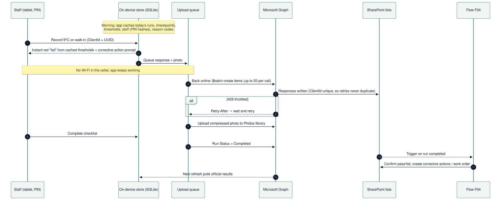
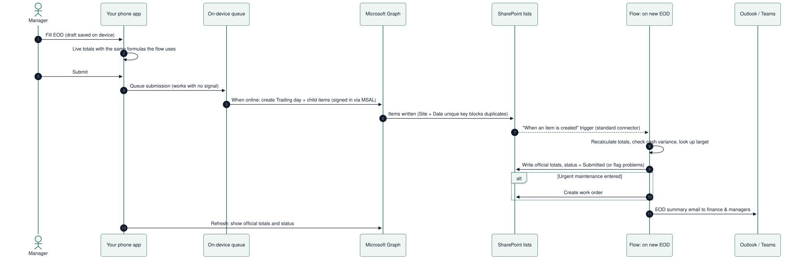
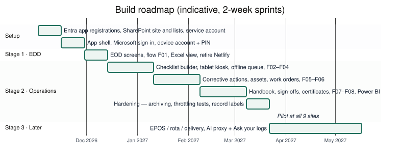

# Tech stack and architecture plan

**Decision:** we build **our own apps** (a kitchen tablet app, a phone app and a web console) and keep Maginhawa's **Microsoft 365** as the backend: **SharePoint** stores the data and files, **Power Automate** runs the business logic, and **Entra ID** handles sign-in. There is no separate server or database to run. Users get fast, purpose-built apps that work offline. Finance keeps Excel, Outlook and Power BI. Running costs stay inside the existing Microsoft 365 licences as long as we stick to **standard connectors**. This setup comfortably handles Maginhawa's **9 sites**. With the design rules in the scalability section it stretches to roughly 20–40 sites. It is an **internal tool**. If the product is later sold to other restaurants, or grows past ~50 sites, the data moves to a database. The Postgres design for that is kept in the `postgres-option/` folder, and keeping all data access in one module makes the move a backend swap rather than a rewrite. Several regulatory values, such as temperature limits and inspection intervals, are still **[verify]** items from the product plan. They live as data in SharePoint, never in code.

<h2 style="page-break-before:always">The simple picture</h2>

Users open **our apps**. The apps sign in through **Microsoft Entra ID** (using the MSAL library), then use the token to call the **Microsoft Graph API**, which reads and writes the **SharePoint** lists and libraries. **Power Automate** sits *beside* SharePoint, not inside Graph: flows start when items change or on a schedule, write results back to SharePoint, and send emails and alerts. Excel and Power BI read SharePoint for finance.

## Architecture at a glance

| Layer | Choice | Why | Notes |
|---|---|---|---|
| **Tablet + phone app** | **Expo (React Native)**, TypeScript | One codebase for iPad and Android tablets and phones. Native speed, an offline store and the camera. Over-the-air updates for quick fixes | The tablet layout is a shared kiosk; the phone layout is for managers |
| **Web console** | **Next.js** (React) + Tailwind; a data-grid component for the spreadsheet view; ExcelJS export | Builder, spreadsheet view, finance and admin screens. Shares types and the data module with the mobile app | Hosted on **Netlify** (already used) or Azure Static Web Apps |
| **Sign-in** | **Entra ID** via **MSAL** | Managers, finance and admins use their own Microsoft accounts. Each kitchen tablet uses a **site device account**, and staff identify themselves with a **PIN** inside the app | Confirm device-account licensing with Maginhawa's Microsoft partner |
| **Data access** | **Microsoft Graph API** (SharePoint list items and drive files) | A standard API, so **no premium licence** and no public URLs. Supports `$batch` (20 requests per call) and `Retry-After` throttling | Wrapped in one `data` module in our code (rule 9) |
| **Data** | **SharePoint site "Maginhawa Ops"**: 31 lists + 7 document libraries | Structured records in lists; photos, policies, certificates, invoices and PDFs in libraries | Version history on; indexes and unique keys defined below |
| **Business logic** | **Power Automate**: 11 flows, owned by a **service account** | Calculations, checks, alerts, emails, scheduling and escalation | Triggered by list changes or on a schedule, not by public HTTP calls |
| **Finance views** | **Excel** (Power Query reading the lists) + **Power BI** | Finance keeps working in Excel; dashboards for sales vs target, wage %, missed checks and repairs | Power BI Pro licences for viewers (check the existing licence) |
| **Notifications** | **Outlook** and **Teams** connectors (standard) | EOD emails, missed-check alerts, reminders and contractor emails | SMS via Twilio is premium, so it comes later |
| **Device management** | **Intune** (if licensed): iPad Guided Access / Android kiosk mode | Locks the shared tablet to our app | |
| **Later, optional** | **Azure Function "AI proxy"** + Claude API; EPOS, rota and delivery connectors; Xero/QuickBooks/Sage | The first small piece of our own backend, needed only because API keys can't live in the apps | Stage 3 |

## Who uses what

- **Kitchen tablet.** It is signed in with that site's **device account**. Staff tap their name and enter a 4-digit PIN. The PIN is checked against an argon2 hash from the `Staff` list that is cached on the device, so login works offline. The session auto-locks after inactivity. Every record stores the staff member, the device and both timestamps.
- **Phone app.** Each manager or owner signs in with their own Microsoft account. They get alerts for exceptions only, sign off corrective actions, close the day, submit the EOD and scan asset QR codes. On small sites without a tablet, staff can use phones too.
- **Web console.** Admins, managers, finance and owners use it to build checklists, view the spreadsheet summary, manage finance, users and settings, and generate the EHO pack.
- **Roles.** Roles come from Entra **security groups** (Staff, Managers, Finance, Admins/Owners) plus the `AppRole` column on `Staff`. Kiosk-only staff need no Microsoft licence.

## Offline-first in our apps

Kitchens and cellars have poor signal. The apps never wait on the network:

1. **Morning cache.** On opening, the app downloads today's checklist runs, checkpoints, thresholds, staff, reason codes and assets into an on-device SQLite store.
2. **Local first.** Every answer saves on the device instantly. The app shows pass or fail straight away from the cached thresholds and prompts for a corrective action on failure.
3. **Upload queue.** Writes are queued and sent through Graph `$batch` when the connection returns. Each record carries a **`ClientId` (UUID)** stored in a unique column, so retries never create duplicates.
4. **Photos.** Photos are compressed on the device (~300 KB) and uploaded in the background to the `Photos` library.
5. **Official result.** Power Automate re-checks the results afterwards (flow F04 for checklists, F01 for the EOD) and writes the official values. The app refreshes and shows them.
6. **Throttling.** When Microsoft throttles requests (HTTP 429), the queue waits for the `Retry-After` time and tries again. Nothing is lost.

## SharePoint site design

One SharePoint site, **"Maginhawa Ops"**, holds everything. Lists store structured records, and libraries store files. Each table in the Postgres design maps to a list, so moving to a database later is a straight copy. The full column-by-column specification is in **Appendix A** and in the machine-readable file `sharepoint/sharepoint-lists.json`, which will also drive the provisioning script.

{{LIST_SUMMARY}}

**Document libraries**

{{LIBRARIES}}

**Design conventions**

- **Unique keys.** Rows that must exist only once use a composite key in `Title` with "enforce unique values" switched on, for example `BUN|2026-10-06` for a trading day, plus a `ClientId` for anything an offline device creates.
- **Filter columns.** Every large list has **indexed `Site` and `BusinessDate`** columns, and **every query filters on them**. Each list has at most 5 indexes including unique keys (SharePoint allows 20) and at most 5 lookup columns (a query allows 12).
- **Flow-owned columns.** Columns marked *set by flow* are written only by Power Automate, and the apps treat them as read-only.
- **Corrections.** A correction is a **new item** whose `Supersedes` column points to the old one, never an edit in place. Version history stays on.
- **Records labels.** Where Maginhawa's Microsoft 365 plan includes **Microsoft Purview retention labels** (check the licence), apply a "record" label to `Responses`, `CorrectiveActions` and submitted `TradingDays`. This blocks edits and deletes and makes the compliance record tamper-resistant.

## Power Automate flows

All flows are **owned by a dedicated service account**, so they don't consume a manager's daily allowance or stop working when someone leaves. They use **standard connectors only** (SharePoint, Outlook, Teams, Excel Online) unless marked premium.

| Flow | Trigger | What it does | Approx. runs per day (9 sites) |
|---|---|---|---|
| **F01 EOD calculate & report** | `TradingDays` item: Status → Submitted | Reads sessions, adjustments, delivery, targets and site settings. Calculates net (discounts subtracted), covers, ASPH, food/drink %, delivery estimated net, total net, wage % and RAG, and net vs target. Flags discount lines that don't match the EPOS total and cash variances with no explanation. Writes official totals; creates work orders from maintenance feedback; emails the EOD summary | ~9 |
| **F02 Create today's checklist runs** | Daily 04:00 | Creates `ChecklistRuns` items from `Schedules`, skipping paused sites | 1 (creates ~54 runs) |
| **F03 Late / missed checks** | Every 15 min during trading hours | Marks overdue runs Missed or Auto-closed and alerts the duty manager (Teams or email) | ~60 |
| **F04 Evaluate completed checklist** | `ChecklistRuns` item: Status → Completed | Re-checks that run's responses against `RulesThresholds`, sets `FailedCount`, creates corrective actions with re-check times and alerts the manager. **One run per checklist, not per answer** | ~54 |
| **F05 Re-check & escalate** | Every 15 min | Finds corrective actions past their re-check time with no passing re-check, or repeat failures on the same asset, and escalates them to a **work order** on that asset | ~60 (most do nothing) |
| **F06 Work order dispatch & updates** | `WorkOrders` item: Status changes | Emails the contractor the job details (photos, asset, site contact), appends to the timeline and notifies the manager on resolution. Contractors reply by email or through a Microsoft Forms link (standard), so they need no login | ~5–15 |
| **F07 Compliance & certificate reminders** | Daily 07:00 | Sends reminders for `ComplianceItems` due within 30 days, expiring `StaffCertificates` and expiring asset warranties | 1 |
| **F08 Policy sign-off requests** | Major version published in `Policies` | Notifies the affected roles and creates sign-off requests. A weekly chase covers anyone who hasn't signed | Occasional |
| **F09 Import targets** | Nightly 02:00 | Reads finance's targets workbook (Excel Online connector) and creates or updates `Targets` | 1 |
| **F10 Weekly owner digest** | Monday 07:00 | Summarises the week by site: sales vs target, wage %, missed checks, open repairs, expiring certificates | 1 |
| **F12 Yearly archive** | 1 January | Copies last year's high-volume items to archive lists or CSV in the `Archive` library, then clears the live lists | 1 per year |

**Finance's existing Flows 2 and 3** (the targets lookup and emails) are replaced by F01, F09 and F10. During the switch-over, F01 can also append the same row to finance's current Excel table, so nothing breaks while they move to the new views.

## Trading / EOD module (replacing the current form)

Today's EOD form is a static Netlify page that calculates in the browser and posts JSON to a **public Power Automate URL**, which appends a row to Excel. A code review of it found five problems:

- The Power Automate signature is visible in the page source, so anyone could submit data.
- **Net sales ignores discounts and comps**, even though the form's label says it includes them.
- The delivery net (`gross ÷ 1.2 × 0.55`) and the wage target (35%) are hard-coded.
- Lunch managers are dropped from the submission.
- Discounts, comps, voids and refunds are flattened into text strings that can't be analysed.

The new module keeps the form's **23 discount/comp reasons**, **15 W/NW void codes** and staff positions as editable lists, and fixes the rest:

| Area | Old form | New module |
|---|---|---|
| Identity | Typed names | Signed-in Microsoft user; approvers are real people |
| Calculations | Browser only; net omits discounts | App preview, then **flow F01** writes the official totals |
| Settings | 20% VAT, 55% delivery retention, 35%/30% wage thresholds in code | Settings in the `Sites`, `DeliveryPlatforms` and `Targets` lists |
| Line items | Text strings | `Adjustments` rows with `ReasonCodes`, amount, approver and time |
| Cash | Warning only | Variance written by F01. The app requires an explanation above 1p, and F01 flags it if missing |
| Duplicates | Possible | Unique Site + Date key |
| Maintenance notes | Text in an email | A `Feedback` item that F01 turns into a **work order** |
| Excel | The only data store | A view that reads the lists (Power Query) |

**Do now, whatever else happens:** regenerate the exposed Power Automate trigger URL.

## AI in this architecture

The apps **cannot hold an AI API key**, because anyone could extract it from the app. So AI arrives in Stage 3 with the **first small piece of our own backend**: an **Azure Function "AI proxy"** in the UK South region. It holds the Claude API key, checks the user's Microsoft sign-in token and queries SharePoint through Graph **as that user**, so it can never see more than the person asking. That enables the features from the product plan:

- **Ask your logs**, with tool calls and record citations
- **Ask the handbook**
- **Reading thermometer photos and invoices**
- **AI-written EOD summaries**

Until then, **Copilot in Power BI** (it needs a specific paid capacity, so check) can answer natural-language questions over the finance dataset.

## Security and data protection

- **Data stays in Maginhawa's Microsoft 365**, in its existing data location, so no new processor is needed for core data. The AI proxy, when added, means signing Anthropic's data processing terms and keeping to UK GDPR data minimisation. Never send health or HR lists to the AI.
- **App registrations** use **delegated Graph permissions limited to the one SharePoint site** (`Sites.Selected`), so the apps can't read anything else in the organisation.
- **No public trigger URLs.** Flows start from list changes or schedules.
- **Permissions by group.** Staff and device accounts can add and read operational lists. Finance has contribute rights on finance lists and read rights on trading lists. Restricted lists (`FitnessToWork`) are open only to Owners/Admins. No item-level permissions are used, because they don't scale.
- **Device management.** Use Conditional Access and Intune where licensed: managed devices only for device accounts, MFA for managers and finance, and remote wipe or revocation (`Devices.Revoked`).
- **Audit.** Version history and SharePoint audit logs, plus optional Purview record labels for tamper-resistance.

## Scalability and limits

Microsoft limits change, so **check the current documentation** before relying on any number below.

**Expected volume at Maginhawa (9 sites, estimate):** about 1,250 new list items a day (≈800 checklist answers plus runs, EOD rows, discounts/comps/voids and staff rows). That is **about 460k items a year**, plus about 80 photos a day, **about 9 GB a year** once compressed.

| Component | Limit | Risk at 9 sites |
|---|---|---|
| Our apps (Expo, Next.js on Netlify) | Effectively none | ✅ None |
| SharePoint list size | ~30 million items per list | ✅ Fine |
| **5,000-item list view threshold** | Queries that don't filter on an **indexed** column fail once a list has more than 5,000 items; up to 20 indexes per list | ⚠️ `Responses` passes 5,000 within weeks. Index and always filter (rule 2) |
| Lookup columns per query | 12 | ✅ Max 5 per list in this design |
| Microsoft Graph throttling | Per-user and per-app limits; returns 429 + `Retry-After` | ✅ Low; the app retries (rule 7) |
| **Power Automate daily action allowance** | Per licence, **charged to the flow owner**; standard Microsoft 365 allowances are modest | ⚠️ **Main risk.** A flow per checklist answer would use thousands of actions a day (rule 1) |
| Flow trigger delay | SharePoint triggers poll, so a flow can take minutes to start on standard licences | ⚠️ Fine for EOD and alerts. The app shows an instant preview, so users never wait |
| Storage | Organisation pool ~1 TB plus extra per licence | ✅ Fine with on-device compression (rule 5) |
| Reporting across history | SharePoint isn't an analytics engine | ⚠️ Power BI imports on a schedule (rule 8) |

**Rules that keep it scaling**

1. **Don't run a flow per checkpoint answer.** Trigger on the **completed checklist** (F04), or run a scheduled batch every 10–15 minutes. This is the biggest saving.
2. **Index `Site`, `BusinessDate` and `Status`, and always filter on them.** Never load a whole list, in the app, the flows or Power Query.
3. **Archive yearly** (F12). Keep the live lists to the current year.
4. **Batch writes** with Graph `$batch` (20 per call) and **cache reference data** on the device.
5. **Compress photos on the device** before upload.
6. **Flows are owned by a service account** with a licence suited to the load. Move the busiest flows to a premium or per-flow licence if allowances run short.
7. **Honour `Retry-After`** when throttled. The offline queue does this automatically.
8. **Power BI uses scheduled imports**, not live list queries.
9. **Keep all data access in one module of our code.** Swapping SharePoint for Dataverse, Azure SQL or Postgres then only touches that module.

**When to move off SharePoint:** at **50+ sites**, when **selling to other companies**, when you need **true record immutability** without Purview, when you need **heavy AI or analytics over history**, or when flow allowances keep running out despite rules 1 and 6. Thanks to rule 9, the apps don't change.

## Licensing checklist

| Item | Standard (in Microsoft 365) | Premium / extra |
|---|---|---|
| SharePoint, Outlook, Teams, Excel Online connectors | ✅ | |
| Graph API from our apps | ✅ | |
| Flows triggered by list changes or schedules | ✅ | Busy flows may need a premium/process licence (rule 6) |
| HTTP-trigger flows, SMS (Twilio), Word→PDF templates, Dataverse, custom connectors | | £ Premium |
| Power BI viewers | | £ Power BI Pro (unless already licensed) |
| Purview record labels, Intune, Conditional Access | Depends on plan (e.g. Business Premium / E3) | Check |
| Kitchen tablet device accounts | | Confirm with the Microsoft partner |
| Azure Function AI proxy (Stage 3) | | £ Small Azure consumption + Claude API usage |

## Build order

| Sprint (2 weeks) | Build |
|---|---|
| 1 | Entra app registrations (`Sites.Selected`), service account, **SharePoint site and lists provisioned from `sharepoint-lists.json`**, seed reference data (sites, reason codes, positions, platforms) |
| 2 | App shell (Expo + Next.js monorepo), MSAL sign-in, device account + PIN, the `data` module over Graph with an offline queue |
| 3 | **EOD screens + F01 + Excel view; retire the Netlify form** (Stage 1 quick win) |
| 4–5 | Checklist builder (console), tablet kiosk checklists with media, F02, F03, F04 |
| 6–7 | Corrective actions, assets + QR, work orders, contractors, F05, F06, day closure and spreadsheet view |
| 8–9 | Handbook and policies, sign-offs, certificates, F07, F08, F09, F10; Power BI dashboards |
| 10 | Hardening: indexes check, load test at 3× volume, throttling test, F12 archive dry run, Purview labels; **pilot at all 9 sites** |
| Stage 3 | EPOS, rota and delivery auto-fill; AI proxy + Ask your logs; statutory calendar, allergens, probes |

## Decisions to confirm

1. **Microsoft 365 plan** (Business Standard, Business Premium or E3/E5). This decides Purview labels, Intune and Conditional Access.
2. **Device accounts for kitchen tablets.** Confirm the licensing approach with the Microsoft partner.
3. **Power BI licences** for finance and owners.
4. **Net sales formula.** Is EPOS "gross" before or after discounts? This is set by `Sites.NetSalesRule`.
5. **Delivery estimate.** Keep 55% retention per platform, or capture actual payouts weekly?
6. **Finance's Excel.** Keep the existing workbook layout, fed by F01 during the switch-over, or move straight to the Power Query view?
7. **Who owns the service account and the flows** inside Maginhawa's IT.
8. **Food-safety thresholds and inspection intervals.** Every `RulesThresholds` and `ComplianceItems` value starts unverified until a consultant signs it off.

---

## Appendix A: SharePoint list specification

*Tags: **unique** = "enforce unique values" (indexed); **indexed** = column index; **set by flow** = written only by Power Automate.*

{{LIST_DETAIL}}

## Appendix B: the database option (if we ever sell it)

The original architecture uses **Postgres on Supabase** in London, PowerSync offline sync and a small Node API. Its full write-up, tested `schema.sql` (67 tables) and diagrams are kept in `postgres-option/`. Use it if the product is sold to other restaurants or grows beyond ~50 sites. The SharePoint lists mirror those tables, so migrating is a data copy, and because of rule 9 the apps keep working.
